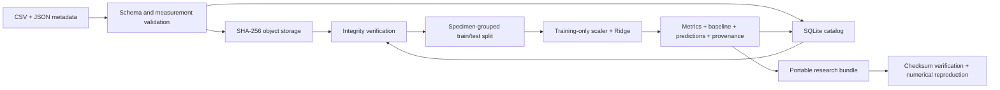

# FAIR-Oriented Materials Data Management and ML Reproducibility

A working Python and SQL research-data workflow for registering materials datasets, preserving metadata and data snapshots, and reproducing machine-learning experiments.

## Goals

- Make datasets searchable through structured metadata and a SQL catalog.
- Preserve immutable input snapshots and detect accidental corruption.
- Keep repeated measurements from the same specimen together during model evaluation.
- Record data hashes, model parameters, splits, predictions, software versions, and Git provenance.
- Export portable research bundles with JSON-LD metadata and executable reproduction checks.

## Implemented capabilities

| Component | Behavior |
| --- | --- |
| Metadata validation | JSON Schema 2020-12, UUID/date checks, licenses, provenance, fixed units |
| Data validation | Unique measurement IDs, finite numeric values, supported physical ranges |
| Storage | SHA-256-addressed CSV objects, atomic file writes, SQLite catalog and run records |
| Discovery | Parameterized SQL title search |
| ML workflow | Specimen-grouped holdout, training-only scaling, Ridge regression, mean baseline |
| Run evidence | Saved partition IDs, predictions, portable JSON model coefficients, metrics, versions, Git commit and dirty state |
| Export | CSV, metadata, run manifest, RO-Crate 1.2-style JSON-LD, checksum manifest |
| Verification | Integrity checks and optional numerical reproduction of splits, metrics, and predictions |
| Automation | Unit/integration checks and complete demonstration in GitHub Actions |

The included data are **synthetic demonstration data**, comprising 180 measurements from 60 simulated specimens. Demonstration metrics measure workflow behavior; they are not scientific findings or evidence of laboratory validation.

## Quick start

From the repository root, run `cd projects/fair-materials-reproducibility`. This project uses its own virtual environment and dependency lock.

Python 3.12 is tested in CI. A network connection is needed for installation; processing is local afterward.

```bash
python -m venv .venv
source .venv/bin/activate
python -m pip install -r requirements.lock
python -m pip install --no-build-isolation --no-deps -e .
python -m unittest discover -s tests -v
python examples/run_workflow.py
```

The last command prints validation and model results and creates:

```text
workspace/demo/                 synthetic input CSV and metadata
workspace/store/catalog.sqlite  dataset and run catalog
workspace/store/objects/        content-addressed data snapshots
workspace/store/runs/           run manifests
workspace/bundles/<run-uuid>/    portable exported research bundle
```

Run the individual steps with the CLI:

```bash
fair-materials demo workspace/demo
fair-materials validate workspace/demo/materials.csv workspace/demo/metadata.json
fair-materials --root workspace/store ingest workspace/demo/materials.csv workspace/demo/metadata.json
fair-materials --root workspace/store search synthetic
fair-materials --root workspace/store train 87370b13-1ab1-4cbb-97ef-0faf74655b23 --seed 42
# Substitute the run_id printed above:
fair-materials --root workspace/store export RUN_ID workspace/exported-run
fair-materials verify workspace/exported-run --reproduce
```

Commands emit JSON. Validation failures exit with status 2. Export refuses to overwrite an existing destination. Re-registering an identical dataset UUID and content is idempotent; changing data or metadata requires a new UUID.

## Architecture



## Research basis and scope

Design choices follow the [FAIR Guiding Principles](https://doi.org/10.1038/sdata.2016.18), the [RO-Crate 1.2 specification](https://www.researchobject.org/ro-crate/specification/1.2/), and [scikit-learn guidance on leakage and reproducibility](https://scikit-learn.org/stable/common_pitfalls.html). See [research and design](docs/research.md), [data contract](docs/data-contract.md), [implementation steps](docs/implementation.md), and [storage operations](docs/operations.md).

This is a FAIR-oriented reference implementation. Local UUIDs do not supply globally resolvable persistent identifiers. The exporter has not undergone external RO-Crate conformance validation. Repository creation does not establish a managed laboratory service, public dataset discovery, long-term preservation, or scientific model validation. Those steps require institutional infrastructure and domain evidence.

## Licenses

Software is released under the MIT license. The included synthetic example data and its metadata are dedicated under CC0-1.0; see [DATA_LICENSE](DATA_LICENSE). Imported datasets must carry their own permitted license in metadata. No real experimental data or third-party datasets are bundled.
