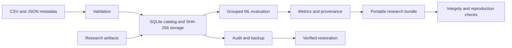

# FAIR-Oriented Materials Data Management and ML Reproducibility

## Objective

Organize materials research data and computational artifacts through structured metadata, traceable storage, and reproducible machine-learning evaluation.

## Implemented work

- Python workflows for dataset ingestion, validation, discovery, and export.
- SQLite catalog with dataset, experiment-run, and artifact relationships.
- Structured JSON metadata for provenance, materials, acquisition batches, instruments, calibration dates, processing conditions, and physical units.
- SHA-256-addressed data snapshots and streaming storage for raw files, model weights, architecture definitions, microscopy, and metrology artifacts.
- Signal features for calibrated force, torque, vibration, and temperature channels, with timestamp and sampling-rate validation.
- Specimen-grouped holdout regression and nested grouped model selection with training-only preprocessing.
- Model and baseline metrics, recorded partitions, predictions, coefficients, software versions, and Git provenance.
- Portable evaluation bundles with JSON-LD metadata, checksum verification, and numerical reproduction.
- Catalog audits, consistent storage snapshots, and verified backup restoration.

## Validation

26 automated project tests cover metadata and measurement validation, artifact integrity, group separation, model reproduction, signal features, command-line execution, and backup recovery.

The included datasets are synthetic: 180 strength measurements from 60 simulated specimens and a 20 kHz force-signal example. These examples validate software behavior; they are not laboratory measurements.

## Architecture

## Technical documentation

| Document | Contents |
| --- | --- |
| [Research basis](docs/research.md) | References and methodology |
| [Data contract](docs/data-contract.md) | Measurement, metadata, signal, and artifact formats |
| [Implementation](docs/implementation.md) | Completed components and validation |
| [Storage operations](docs/operations.md) | Storage semantics, auditing, and recovery |
| [Technical scope](docs/scenarios.md) | Supported capabilities and operating boundaries |

## Software environment

Python 3.12. Direct and transitive dependencies are pinned in `requirements.lock`. Package configuration is in `pyproject.toml`; the command-line entry point is `fair-materials`. Executable examples are in `examples/` and automated tests are in `tests/`.

## Licenses

Software: [MIT](LICENSE). Included synthetic datasets and metadata: [CC0-1.0](DATA_LICENSE). Imported datasets retain their declared licenses.
