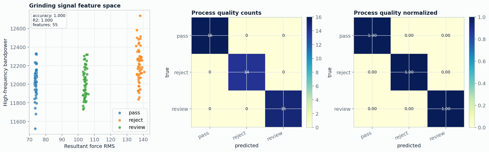

# Process signal ML

[Back to project index](../README.md) | [Back to main README](../../README.md)

## Data Note

The signal files used here are synthetically generated force/moment signals designed to reproduce a high-frequency process-monitoring workflow. They do not contain proprietary experimental data from previous employment or industrial work.

## Methods

- generated synchronized high-frequency force/moment channels
- segmented the signal into analysis windows
- extracted RMS, peak, crest factor, spectral centroid, bandpower, resultant force, and energy features
- trained baseline models for process-state classification and property regression
- saved signal plots, feature tables, and metrics

## Results

| Task | Data | Model | Result |
|---|---|---|---|
| process-state classification | 20 kHz force/moment windows | Random Forest | accuracy `1.0000` |
| property regression | 20 kHz force/moment windows | Random Forest | R2 `0.9998` |

## Figures



Metrics: [results/materials_signal_metrics.json](results/materials_signal_metrics.json)

## Main Files

- `scripts/run_materials_signal.py`
- `configs/materials_signal.json`
- `src/microscopy_cv_research/signals/features.py`
- `src/microscopy_cv_research/training/materials_signal.py`

## Run

```powershell
python scripts/run_materials_signal.py --config configs/materials_signal.json
```
