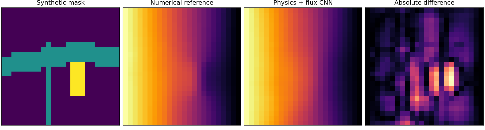
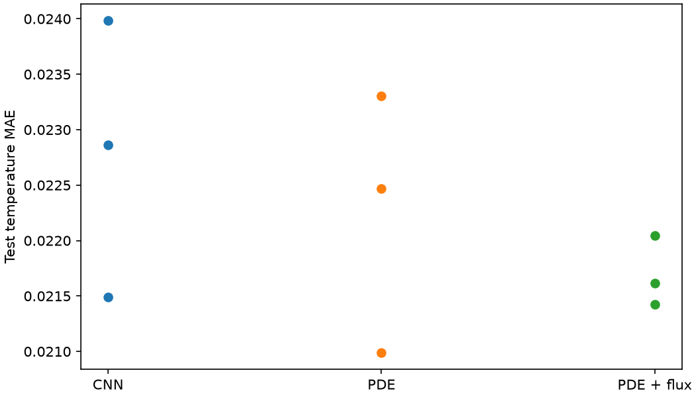

# Physics-informed heat transport from SEM microstructures

A finite-volume heat solver and a physics-regularized CNN operating on segmented NASA environmental barrier coating (EBC) micrographs. This is a separate project; the original [SEM segmentation](../sem-segmentation) code is unchanged.

**Scientific status:** Synthetic numerical model and three-loss ablation implemented. Real NASA EBC annotation geometry can be analyzed. The original trained SEM U-Net checkpoint is not in the repository, so **image-to-transport validation remains incomplete**.

## Phase definitions and limits

NASA EBC annotations have labels 0 background, 1 oxide, 2 crack. Background is not necessarily one physical material. All thermal conductivities here are **illustrative dimensionless values**, not experimentally measured coefficients. The original U-Net reports foreground IoU 0.439 and crack IoU 0.126; crack segmentation error could significantly affect a thermal proxy.

## Physics and models

The solver handles div(k grad T)=0 with opposing fixed-temperature boundaries 1/0 and insulated other boundaries. Both x and y image directions are implemented, using harmonic-mean interface conductance and a sparse finite-volume solver. Interpreting image y as through-thickness requires checking actual image orientation.

Three CNN variants share the same convolutional architecture and inputs (one-hot labels, phase conductivity, x/y coordinate channels):

1. Supervised CNN trained on numerical temperature fields.
2. CNN with an added finite-volume conservation residual.
3. CNN with conservation and numerical boundary-flux supervision.

The third term is **supervised flux regularization**, not an independent physical measurement.

## Reproducibility

Run from the repository root with Python 3.12:

- Install: python -m pip install -r projects/sem-physics-ml/requirements.txt
- Tests: python -m pytest -q tests/test_sem_physics_ml.py tests/test_sem_methods.py tests/test_sem_validate.py tests/test_sem_nasa_cases.py
- Repeated synthetic experiments: python projects/sem-physics-ml/benchmark_v2.py --epochs 65 --seeds 5 17 29
- Real NASA annotation study: python projects/sem-physics-ml/run_nasa_cases.py
- Analyze an annotation directly: python projects/sem-physics-ml/validate_sem.py --mask path/to/EBC_annotation.tif --direction y
- Compare U-Net prediction to annotation after obtaining actual weights: python projects/sem-physics-ml/validate_sem.py --mask path/to/annotation.tif --image path/to/image.tif --sem-checkpoint path/to/sem_ebc_unet.pt

Synthetic training uses 48 training, 16 validation and 24 test maps at 24x24 resolution, with three initialization seeds (5,17,29), fixed background k=1, oxide k sampled 0.15–0.75 and crack k sampled 0.015–0.12. All values are assumptions. Downsampling may erase thin cracks; results record original and downsampled class fractions.

[Extended synthetic benchmark](results/v2/benchmark.md) | [NASA EBC annotation transfer](results/real_annotations/nasa_ebc_cases.md) | [Research report](research_report.md)

## Files

- physics.py, model.py — original finite-volume solver and transport CNN
- methods.py — directional conduction, conservation and mask morphology
- benchmark_v2.py — variable conductivity and multi-seed three-model experiment
- validate_sem.py — annotation-based numerical check and optional U-Net comparison
- run_nasa_cases.py — NASA real-geometry study without original U-Net weights
- predict.py — compatibility adapter for original SEM U-Net checkpoint
- results/ — synthetic and real-annotation reports, with provenance information

This 2-D simulation-supervised surrogate has not been calibrated or validated for 3-D thermal conductivity, oxidation resistance, or coating lifetime. The numerical reference and physics loss use the same discretization.

Sources: [NASA EBC](https://github.com/nasa/pretrained-microscopy-models), [NASA AQUAMI-TGO](https://github.com/nasa/AQUAMI-TGO), [Zhu et al. 2026](https://doi.org/10.1016/j.icheatmasstransfer.2026.111898).
