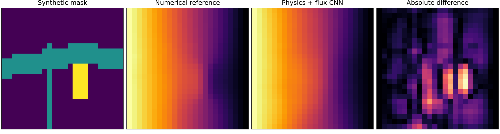
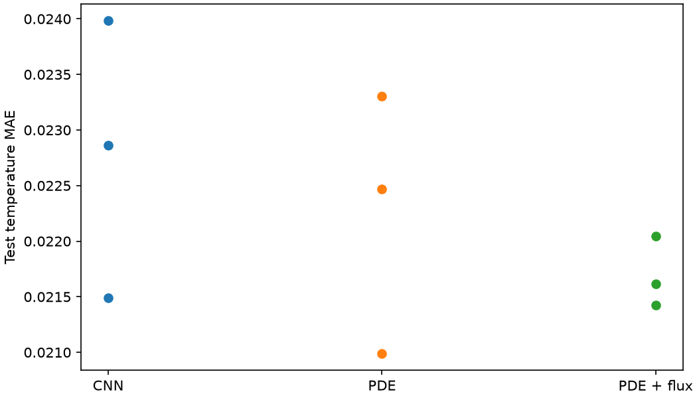

# Synthetic variable-conductivity study

Three separate seeds on the same synthetic test maps (no measured thermal labels).

| Metric | Data-only CNN | CNN + PDE | CNN + PDE + flux | Flux improves vs baseline |
|---|---:|---:|---:|---:|
| temperature_mae | 0.02278 | 0.02225 | 0.02169 | 2/3 |
| pde_residual_rmse | 0.01797 | 0.01360 | 0.01419 | 3/3 |
| relative_proxy_error | 0.28706 | 0.29075 | 0.13060 | 3/3 |

24-mask CPU batch inference: CNN 0.00106 s, finite-volume solver 0.22611 s. Ratio FVM/CNN 213.5x.
Speed depends on hardware and size, and excludes model training.
Flux loss uses numerical reference flux; this is supervised flux regularization, not an independent physical measurement.

